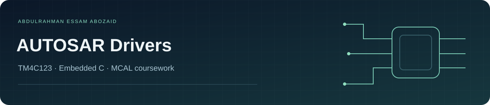
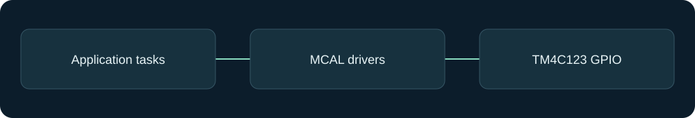
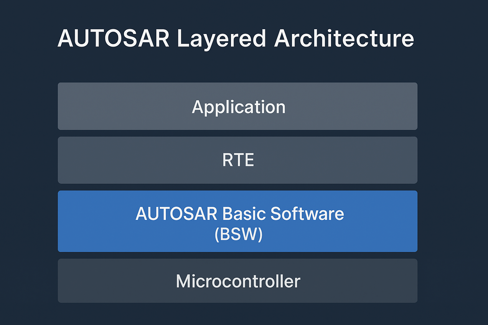

# AUTOSAR Drivers

AUTOSAR software architecture coursework and driver exercises for the TM4C123GH6PM. The repository brings together a DIO workspace and an application workspace with Port, DIO, MCU, timing, button and LED modules.

[Overview](#overview) · [Repository files](https://github.com/AbdulRahmanEssamAbozaid/AUTOSAR/tree/master)

## Overview

## Explore the repository

| Location | Purpose |
| --- | --- |
| [DIO workspace](AUTOSAR_Dio_WS/Dio_MT) | DIO driver, configuration and a small main program. |
| [Application workspace](AUTOSAR_Project_WS/AUTOSAR_Project) | Port configuration, application tasks and board support. |
| [Port configuration](AUTOSAR_Project_WS/AUTOSAR_Project/Port_PBcfg.c) | Pin configuration used by the application. |

## Open and build

1. Install Code Composer Studio with TM4C support and a compatible TI ARM compiler. The checked-in project records CCS 12.4.0 and compiler 20.2.7.LTS.
2. Import the existing CCS project from the workspace you want to explore.
3. Select TM4C123GH6PM and review the linker file, clock configuration and pin assignments.
4. Build the project, then use a matching Tiva C board and debugger to inspect its behavior.

The repository contains separate CCS projects. Build the selected project through its project configuration.

## Architecture reference

The application schedules button, LED and application tasks. Start with [App.c](AUTOSAR_Project_WS/AUTOSAR_Project/App.c), then follow calls into the configured drivers.

## Course material and attribution

The existing coursework references **Mohamed Tarek**. Source-file author notices and course attribution are retained. The [original course notes](docs/original-readme.md) cover layered architecture, driver concepts, configuration variants, MISRA and functional safety topics.
